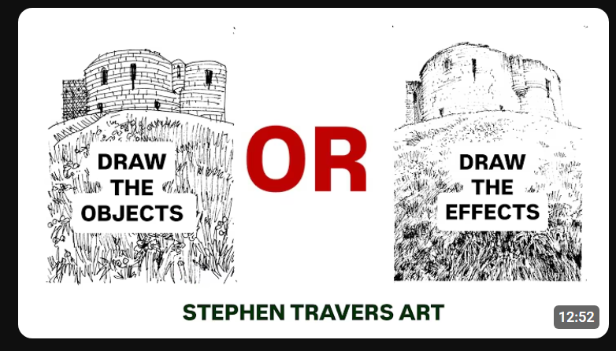

# Về bài A Pixel Is Not A Little Square

Link ở đây: https://alvyray.com/Memos/CG/Microsoft/6_pixel.pdf

Trước hết, có thể định nghĩa rằng:

Representation = projection/mapping/encoding từ một space sang một space biểu diễn khác.

Ví dụ như khi ta chụp 1 tấm hình, và lưu trữ trong điện thoại, cái file hình là representation của cái hình ảnh đó. Hoặc là khi quay hình 1 em gái lắc đít thì cái vid tiktok là 1 cái representation của cái sự việc em gái nhảy nhót.

Không chỉ như vậy, những thứ như embedding vector, hay việc truyền lời từ sếp tổng tới nhân viên qua vài cấp, việc ta nghĩ ra 1 ý và chat với người khác, tất cả đều có thể coi là 1 sự representation.

Khi projection không phải 1-1, và phần lớn trường hợp thực tế là vậy, thì thông tin sẽ bị mất mát (hoặc đơn giản ta có thể coi là biến dạng). 

Quay lại vấn đề về pixel, raster image chỉ là một ví dụ rất điển hình: raster image tập hữu hạn các giá trị pixel.

Trong khi đó, thứ mà ban đầu ta muốn truyền tải, ví như 1 bức hình tòa lâu đài trên 1 đồng cỏ, thì còn không khí dịu nhẹ, làn gió vuốt ve cỏ cây, và dĩ nhiên rất nhiều thứ khác. Giống như so sánh dưới đây: draw the objects hay draw the effects?

   
  <i>Draw the objects hay draw the effects?</i>

Mental model “pixel là ô vuông” không sai trong mọi ngữ cảnh, nhưng nó dễ khiến người ta đồng nhất representation với object được represent. Khi đó ta ít nghĩ tới những câu quan trọng như: cái gì đã bị mất? cái gì bị alias? cái gì chỉ là approximation? reconstruction nào đang được giả định?

Thật ra, khi apply các filter, ta lập tức dễ dàng thoát ra khỏi mental model mỗi pixel là một ô vuông độc lập, đồng nhất với giá trị của nó - điều đã được tác giả đưa ra ví dụ trong bài.

Đây có lẽ là phần có giá trị nhất nếu ta khái quát bài viết hơn: đừng nhìn một representation như thể nó là bản thân thực tại; hãy nhìn nó như kết quả của một phép chiếu có giả định và có tổn thất thông tin. Pixel chỉ là case study.

# Vấn đề rộng hơn

Tay trái chỉ trăng, người mù xem voi (tích của Ấn Độ) cũng đều ít nhiều có khái niệm này luôn.

Ý tưởng “representation luôn có thể làm mất thông tin” không mới, nhưng việc dùng nó như một mental model xuyên nhiều lĩnh vực thì không phải lúc nào cũng được nói rõ. 

Điểm hay là mental model này có thể áp dụng rất rộng: metric đại diện cho performance, GDP đại diện cho nền kinh tế, vector embedding đại diện cho văn bản, database schema đại diện cho thế giới thực, requirement đại diện cho nhu cầu người dùng, thậm chí ngôn ngữ đại diện cho suy nghĩ.

Mình cho rằng có chút ironic với bài của Smith: có thể ông có một intuition rộng hơn trong đầu - “đừng nhầm representation với thứ được represent” nhưng khi viết ra lại projection nó thành một luận điểm rất hẹp: “pixel is not a little square.”, có nhắc tới nhưng chưa nói rõ luận điểm này ra. Chẳng phải cũng là 1 ví dụ cho việc "một ý niệm giàu hơn bị mất thông tin khi được encode thành một thông điệp cụ thể" đó hay sao?

Tuy vậy, mất mát thông tin không phải luôn tệ. Thực ra representation thường phải bỏ bớt thông tin. Một bản đồ tàu điện không cần giữ chính xác hình dạng địa lý của thành phố (cứ ra metro thấy liền). Một KPI cần đơn giản để nhân viên đọc cái hiểu ngay. Câu hỏi quan trọng hơn là:

> Representation đã giữ lại cái gì, bỏ đi cái gì, và những thứ nó giữ lại có phù hợp với mục đích của ta hay không?

Giống như việc apply các filter, hay đơn giản là câu hỏi phía trên: Draw the objects hay draw the effects vậy?